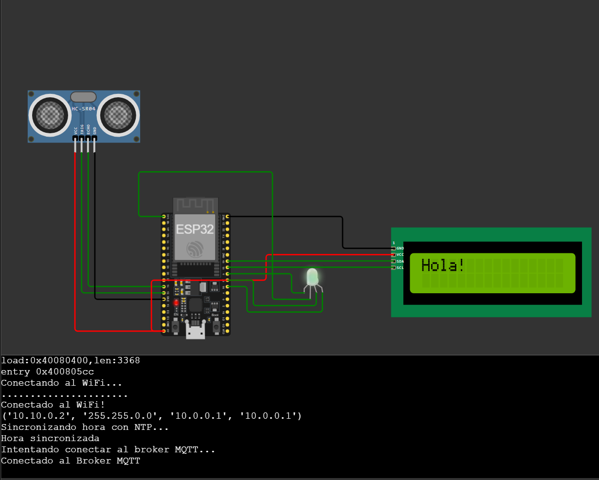

# Mama System

**Mama System** es un sistema embebido desarrollado en **MicroPython** sobre **ESP32** que automatiza la iluminación y el acompañamiento de rutinas diarias en la habitación de un estudiante, integrando control horario por red, detección de presencia y telemetría IoT en tiempo real por **MQTT**.

## La idea detrás

El proyecto nació con una idea concreta y cotidiana: **recrear de forma automatizada el rol de "una mamá que te organiza el día"** —avisándote cuándo es momento de estudiar con buena iluminación, cuándo frenar para comer o descansar, cuándo volver al escritorio si te distraes demasiado tiempo y cuándo apagar las luces para irte a dormir—.

El nombre **Mama System** surgió gracias a una idea de mi profesor cuando le comenté el proyecto sobre luces, horarios de estudio, comidas y descanso.

Más allá de su enfoque cercano, el sistema busca resolver dos necesidades reales de cualquier estudiante:
1. **Higiene visual y productividad:** Adaptar la tonalidad de la iluminación ambiental según la actividad (luz fría/celeste para estimular la concentración durante el estudio, luz cálida para las pausas y comidas, y apagado total durante el horario de descanso nocturno).
2. **Gestión del tiempo y prevención del desgaste:** Detectar ausencias prolongadas frente al escritorio durante los bloques de estudio y enviar recordatorios visuales y remotos sin interrumpir el descanso nocturno.

## Qué hace y cómo funciona

El controlador sincroniza la hora local (`UTC-3`) mediante **NTP** y ajusta el comportamiento del sistema según el momento del día:

- **07:00 a 12:00 — Modo estudio:** Activa iluminación fría/celeste para favorecer la concentración.
- **12:00 a 13:30 — Hora de comer / descanso:** Cambia a luz cálida para acompañar la pausa.
- **13:30 a 18:00 — Modo estudio:** Retoma el bloque de estudio con luz fría/celeste.
- **18:00 a 23:00 — Tiempo libre:** Mantiene una luz cálida suave para el tramo final del día.
- **23:00 a 07:00 — Hora de dormir:** Apaga las luces y el backlight del LCD, y desactiva las alertas de ausencia para no interrumpir el sueño.

### Detección de presencia y conexión IoT
- **Sensor ultrasónico (`HC-SR04`):** Durante los horarios activos mide la distancia (`<= 80 cm`) para detectar si el usuario sigue en su espacio de trabajo. Si pasan **15 minutos** sin presencia, dispara una alerta en el LCD, pone el LED RGB en rojo y publica el aviso por MQTT.
- **Telemetría MQTT (`Adafruit IO`):** Publica los cambios de estado y alertas en el feed `mumsystem` y mantiene escucha activa de mensajes.

## Stack y arquitectura

- **Hardware / Simulación:** ESP32 DevKitC v4, sensor ultrasónico HC-SR04, display LCD 16x2 (I2C) y LED RGB (PWM).
- **Software:** MicroPython, `ntptime`, `umqtt.simple`, broker MQTT (Adafruit IO) y simulación en Wokwi.
- **Organización del código:** Separación entre la lógica principal (`main.py`), el esquema de conexiones (`diagram.json`) y las librerías de hardware/red (`hcsr04.py`, `lcd_i2c.py`, `const.py`, `typing.py`, `umqtt.simple.py`).

## Mejoras pensadas a futuro

También se proyectaron mejoras como un interruptor físico general, control remoto desde una app para ajustar tiempos y colores, y temporizadores en pantalla.

## Autora y contexto

Cindy Silva López — Estudiante de Ingeniería en Informática (UNLaM).  
Proyecto desarrollado originalmente durante el segundo cuatrimestre de 2024.
